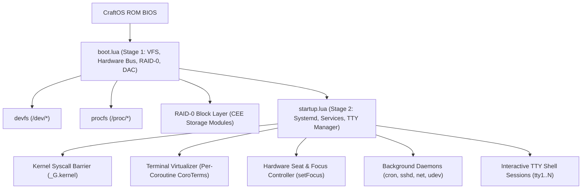
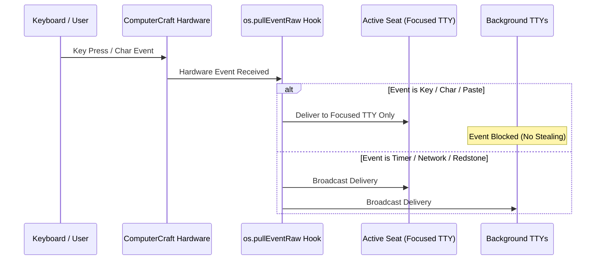

# Luna OS: Kernel & Subsystems Developer API Reference

A comprehensive technical specification of all methods, system calls, virtual device nodes, and runtime abstractions created or intercepted by Luna OS across `boot.lua` (Stage-1 Bootloader/VFS), `startup.lua` (Stage-2 Systemd/Kernel), and userland libraries.

---

## Table of Contents

1. [Architecture & Boot Pipeline](#1-architecture--boot-pipeline)
2. [Filesystem Interception & VFS (fs API)](#2-filesystem-interception--vfs-fs-api)
3. [Virtual Device Nodes (/dev/*)](#3-virtual-device-nodes-dev)
4. [Process Pseudo-Filesystem (/proc/*)](#4-process-pseudo-filesystem-proc)
5. [Terminal Virtualization & Multi-Monitor Engine (term API)](#5-terminal-virtualization--multi-monitor-engine-term-api)
6. [Event Subsystem & Seat Focus (os API)](#6-event-subsystem--seat-focus-os-api)
7. [Kernel Syscall Dispatcher (_G.kernel & _G.SYS)](#7-kernel-syscall-dispatcher-_gkernel--_gsys)
8. [Systemd Subsystem & Security DAC (_G.systemd)](#8-systemd-subsystem--security-dac-_gsystemd)
9. [Shell Environment & Path Isolation (shell API)](#9-shell-environment--path-isolation-shell-api)
10. [Virtual Terminal Library (/usr/lib/tty.lua)](#10-virtual-terminal-library-usrlibttylua)
11. [Networking Layer & Protocol Stack (_G.LunaNet)](#11-networking-layer--protocol-stack-_glunanet)

---

## 1. Architecture & Boot Pipeline

Luna OS is designed as a modular, POSIX-compliant UNIX-like operating system running within ComputerCraft / CC: Tweaked and Create: Computer Energetics (CEE).



### Boot Sequence:
1. **Hardware Discovery (`boot.lua`):** Probes CEE memory modules and peripheral monitors. Mounts physical storage units into a striped RAID-0 volume.
2. **VFS Interception:** The global `fs` table is hooked to intercept `/dev`, `/proc`, and `/boot` paths while transparently wrapping physical storage in Discretionary Access Control (DAC) permission checks. Raw CraftOS methods are retained in `_G.ORIG_FS`.
3. **Stage-2 Handoff (`startup.lua`):** Initializes the `systemd` supervisor, sets up per-coroutine terminal routing, maps connected screens to TTY sessions, configures user credentials, and starts background daemons.

---

## 2. Filesystem Interception & VFS (fs API)

All file I/O operations pass through the Stage-1 VFS abstraction layer. Native implementations are preserved in `_G.ORIG_FS`.

| Method | Status | Signature | Technical Description |
| :--- | :--- | :--- | :--- |
| `fs.open` | **Intercepted** | `fs.open(path, mode)` | Intercepts virtual `/dev/*` nodes, dynamic `/proc/*` metrics, and striped RAID-0 block addresses. Performs DAC permission checks (`r`, `w`, `a`) via `systemd.checkAccess`. Returns either a standard file handle or a virtual stream object. |
| `fs.exists` | **Intercepted** | `fs.exists(path)` | Returns `true` for valid virtual devices, procfs entries, and files on the active storage partition. Resolves relative paths against the active working directory. |
| `fs.isDir` | **Intercepted** | `fs.isDir(path)` | Identifies virtual mount points (`/dev`, `/proc`, `/boot`, `/etc`) as directories. Returns `false` for character and block device nodes. |
| `fs.list` | **Intercepted** | `fs.list(path)` | Combines on-disk directory contents with virtual device registrations (in `/dev`) or active process IDs (in `/proc`). |
| `fs.getSize` | **Intercepted** | `fs.getSize(path)` | Computes exact byte size across striped RAID-0 chunk fragments or calculates dynamic stream lengths for pseudo-files. |
| `fs.attributes` | **Intercepted** | `fs.attributes(path)` | Returns POSIX-compatible file attributes, including numeric octal permission masks (`mode`), owner user, owner group, size, and modification timestamps. |
| `fs.makeDir` | **Intercepted** | `fs.makeDir(path)` | Enforces write permissions on the parent directory before creation. Recursively ensures parent paths exist. |
| `fs.delete` | **Intercepted** | `fs.delete(path)` | Protects system mounts and virtual character devices. Enforces DAC write permissions on target directory. |
| `fs.copy` | **Intercepted** | `fs.copy(src, dst)` | Performs streaming copy across mount boundaries and striped storage volumes, validating read permissions on source and write permissions on target. |
| `fs.move` | **Intercepted** | `fs.move(src, dst)` | Performs atomic move within the same storage module or block-by-block migration across distinct partitions. |
| `fs.isReadOnly` | **Intercepted** | `fs.isReadOnly(path)` | Returns `true` for immutable kernel pseudo-files (`/proc/*`) and system mount points. |

---

## 3. Virtual Device Nodes (/dev/*)

Luna OS exposes hardware, kernel utilities, and terminal sinks as character and block devices inside `/dev/`.

| Node | Perms | Mode | Description |
| :--- | :--- | :--- | :--- |
| `/dev/null` | `0666` | `r`, `w`, `a` | Discards all written bytes; reads return immediate EOF (`nil`). |
| `/dev/zero` | `0444` | `r`, `rb` | Produces an infinite byte stream of binary zeros (`\0`). |
| `/dev/random`, `/dev/urandom` | `0444` | `r`, `rb` | Cryptographically seeded pseudorandom byte generator. |
| `/dev/terminal`, `/dev/console` | `0666` | `w`, `a` | Direct write pipeline targeting the primary computer chassis screen buffer. |
| `/dev/tty` | `0666` | `r`, `w`, `a` | Dynamically points to the virtual workspace / monitor belonging to the caller's running coroutine. |
| `/dev/tty1` .. `/dev/ttyN` | `0660` | `w`, `a` | Writes directly to target virtual workspace buffer, irrespective of which screen is currently in focus. |
| `/dev/mon0` .. `/dev/monN` | `0666` | `w`, `a` | Direct sink for hardware peripheral monitors attached to wired network cables or chassis sides. |
| `/dev/<name>` (e.g. `/dev/left`) | `0666` | `w`, `a` | Named monitor aliases defined in `/etc/conf/system.lua`. |
| `/dev/speaker`, `/dev/sound` | `0660` | `w`, `wb` | Direct audio sink streaming DFPWM / PCM audio chunks to attached audio peripherals. |
| `/dev/raid0` | `0600` | `r`, `w` | Raw block storage interface providing linear byte offset addressing over striped memory modules. |
| `/dev/boot` | `0600` | `r`, `w` | Direct block partition interface targeting the primary boot EEPROM / bootstrap module. |

---

## 4. Process Pseudo-Filesystem (/proc/*)

Kernel runtime metrics and process states are accessible as read-only files in `/proc/`.

| File Path | Output Format | Description |
| :--- | :--- | :--- |
| `/proc/version` | Plain text | Luna OS kernel version, build timestamp, and compiler details. |
| `/proc/uptime` | Plain text | Decimal seconds since machine power-on and idle timer metrics. |
| `/proc/meminfo` | Key-Value | Total, free, and used memory bytes across all detected storage modules. |
| `/proc/cpuinfo` | Key-Value | Host computer architecture, computer ID, and clock frequency. |
| `/proc/partitions` | Tabular | List of mounted memory modules, chunk sizes, and capacity. |
| `/proc/mounts` | Tabular | Mount points, underlying device nodes, filesystem types, and mount flags. |
| `/proc/<PID>/status` | Key-Value | Process name, state (`running`, `sleeping`, `dead`), UID, GID, and parent PID. |
| `/proc/<PID>/cmdline` | Plain text | Full argument string passed when the process was spawned. |

---

## 5. Terminal Virtualization & Multi-Monitor Engine (term API)

The global `term` object is replaced by a thread-aware virtual dispatcher (`vTerm`). Standard ComputerCraft terminal calls automatically execute within the buffer assigned to the active coroutine.

### Dynamic Coroutine Context Resolution (`getCoroTerm`):
```lua
local function getCoroTerm()
    local co = coroutine.running()
    if not co then return nativeTerm end
    if coroTerms[co] then return coroTerms[co] end
    local myTTY = ttyOwners[co]
    if myTTY and ttyTerms[myTTY] then return ttyTerms[myTTY] end
    return nativeTerm
end
```

### Virtualized Terminal Operations:
* `term.write(text)`: Outputs text at the current cursor coordinate on the caller's virtual terminal.
* `term.clear()`: Clears only the virtual screen buffer belonging to the calling coroutine.
* `term.setCursorPos(x, y)` / `term.getCursorPos()`: Controls cursor position within the caller's screen space.
* `term.getSize()`: Returns dimensions computed specifically for the active screen's physical block count and scale.
* `term.setTextColor(color)` / `term.setBackgroundColor(color)`: Sets foreground/background draw colors.
* `term.blit(text, fg, bg)`: High-performance multi-color character blitting directly to the caller's buffer.
* `term.redirect(target)`: Explicitly rebinds output from the current thread to a different screen or `window` object.
* `term.native()`: Always returns the raw physical computer chassis terminal, bypassing virtualization.

---

## 6. Event Subsystem & Seat Focus (os API)

Luna OS hooks `os.pullEvent` and `os.pullEventRaw` to provide seat isolation across multi-monitor setups.



### Focus APIs:
* **`_G.setFocus(target)`**
  * **Parameters:** `target` (*string|number*) — Device path (`"/dev/mon1"`), alias (`"left"`), or workspace number (`1`).
  * **Returns:** `boolean, string?` — `true` on success, or `false, err` if target device is not found.
  * **Effect:** Directs subsequent keyboard strokes and text input exclusively to the specified screen.
* **`_G.getFocus()`**
  * **Returns:** `string` — Canonical device path of currently focused terminal (e.g. `"/dev/mon1"`).
* **`_G._DEVICE_MONITORS`**
  * **Type:** `table<string, table>` — Global mapping of all registered device names and paths to monitor terminal objects.

---

## 7. Kernel Syscall Dispatcher (_G.kernel & _G.SYS)

Kernel procedures run behind a privilege barrier executed via `_G.kernel.syscall(SYS_ID, ...)`.

| Syscall | Code | Arguments | Return Values | Description |
| :--- | :---: | :--- | :--- | :--- |
| `SYS.EXIT` | 1 | `(code)` | `void` | Terminates calling process and returns exit code. |
| `SYS.SPAWN` | 2 | `(name, cmd, targetUser, ppid)` | `pid` or `nil, err` | Spawns a new process in an isolated thread. |
| `SYS.READ` | 3 | `(fd, count)` | `data` | Reads up to `count` bytes from file descriptor. |
| `SYS.WRITE` | 4 | `(fd, data)` | `bytesWritten` | Writes string or binary buffer to descriptor. |
| `SYS.OPEN` | 5 | `(path, mode)` | `fd` or `nil, err` | Opens virtual or physical file with DAC check. |
| `SYS.CLOSE` | 6 | `(fd)` | `boolean` | Flushes and closes file descriptor. |
| `SYS.GETPID` | 7 | `()` | `pid` | Returns process ID of caller. |
| `SYS.GETPPID` | 8 | `()` | `ppid` | Returns parent process ID of caller. |
| `SYS.KILL` | 9 | `(pid, signal)` | `boolean, err?` | Sends POSIX signal to target PID. |
| `SYS.SYNC` | 10 | `()` | `boolean` | Flushes dirty filesystem buffers to physical drives. |
| `SYS.REBOOT` | 11 | `()` | `void` | Syncs filesystem and reboots machine. |
| `SYS.POWEROFF` | 12 | `()` | `void` | Syncs filesystem and powers off machine. |
| `SYS.UPTIME` | 13 | `()` | `number` | Returns system uptime in seconds. |
| `SYS.UNAME` | 14 | `()` | `table` | Returns `{ sysname, nodename, release, version, machine }`. |
| `SYS.PROCLIST` | 15 | `()` | `table` | Returns list of all active process descriptors. |
| `SYS.CHECKACCESS`| 16 | `(path, req)` | `boolean` | Validates caller permissions for `'r'`, `'w'`, or `'x'`. |
| `SYS.GETUSER` | 17 | `()` | `string` | Returns active username associated with thread. |
| `SYS.SETUSER` | 19 | `(newUser)` | `boolean, err?` | Switches thread user identity (root only). |
| `SYS.HOSTNAME` | 21 | `[newHostname]` | `string` | Gets or sets machine network hostname. |
| `SYS.USERADD` | 22 | `(username, ...)` | `boolean, err?` | Registers a new user account with home directory. |
| `SYS.USERDEL` | 23 | `(username, rmHome)`| `boolean, err?` | Removes existing user account from system. |
| `SYS.DEVLIST` | 24 | `()` | `table` | Lists all detected hardware devices and buses. |
| `SYS.GETHOME` | 25 | `(user)` | `string` | Returns canonical home directory path for user. |
| `SYS.GETCONFIG` | 26 | `(app, user)` | `string` | Resolves standard `/etc/conf/` or `~/.config/` directory. |
| `SYS.GETTTY` | 27 | `()` | `string` | Returns TTY name bound to calling thread. |
| `SYS.SETTTY` | 28 | `(targetTTY)` | `boolean` | Migrates calling thread to another virtual terminal. |

---

## 8. Systemd Subsystem & Security DAC (_G.systemd)

`_G.systemd` enforces Discretionary Access Control (DAC) security policies and manages background daemons.

### User & Authentication Methods:
* **`systemd.getUser(username)`**: Returns user table `{ uid, gid, home, shell, password }`.
* **`systemd.verifyPassword(username, password)`**: Compares input password against stored salted hash.
* **`systemd.setPassword(username, newPass)`**: Updates password hash for specified account.
* **`systemd.userAdd(username, password, uid, gid, gecos, home, shell)`**: Creates account and initializes home directory.
* **`systemd.userDel(username, removeHome)`**: Deletes user and optionally purges `/home/<user>`.

### DAC Security Engine:
* **`systemd.checkAccess(path, user, req)`**:
  * Evaluates `'r'`, `'w'`, or `'x'` requests.
  * Root account (`user == "root"`) automatically bypasses checks.
  * Standard users are matched against Owner bits, Group bits, and Others bits.
* **`systemd.chmod(path, mode)`**: Sets octal mode permissions (`"0755"`, `"0600"`).
* **`systemd.chown(path, owner, group)`**: Updates owner UID/name and GID/group name.

### Daemon Lifecycle Controller:
* **`systemd.serviceList()`**: Returns status table of all configured system services.
* **`systemd.serviceStart(name)`**: Launches background daemon in a supervised thread.
* **`systemd.serviceStop(name)`**: Terminates background daemon.
* **`systemd.serviceEnable(name)`**: Marks daemon for automatic startup on system boot.
* **`systemd.serviceDisable(name)`**: Disables automatic startup on system boot.

---

## 9. Shell Environment & Path Isolation (shell API)

Luna OS sanitizes the execution environment to prevent ROM contamination and ensure reliable POSIX-style script execution.

| Method | Status | Description |
| :--- | :--- | :--- |
| `shell.resolveProgram(command)` | **Intercepted** | Searches command strictly within `/usr/bin/core`, `/usr/bin/extra`, `/usr/bin`, and `/etc`. Explicitly blocks `/rom/` leaks. |
| `shell.programs()` | **Intercepted** | Discovers all installed userland utilities across Luna PATH without standard CraftOS ROM tools. |
| `shell.complete(line)` | **Intercepted** | Context-aware autocompletion for programs, flags, and local filesystem paths. |
| `shell.setPath(path)` | **Standard** | Configures colon-separated binary search paths. |
| `shell.setDir(dir)` | **Standard** | Sets active working directory. |
| `shell.setAlias(alias, target)` | **Standard** | Registers short command aliases (e.g. `adduser` -> `useradd`). |

---

## 10. Virtual Terminal Library (/usr/lib/tty.lua)

The `tty` library provides programmatic multi-screen and workspace controls for userland software.

```lua
local tty = require("tty")

-- Enumerate all active TTYs and attached monitors
local workspaces = tty.list()

-- Send notification directly to monitor 2 without stealing user focus
tty.write("tty2", "Background build completed successfully.\n")

-- Switch interactive keyboard focus to monitor 2
tty.switch("tty2")
```

### Method Summary:
* **`tty.list()`**: Returns table of all available workspaces, their TTY identifiers, and mapped peripherals.
* **`tty.get(name)`**: Returns the virtual terminal object for the given TTY.
* **`tty.current()`**: Returns the TTY identifier running the calling process.
* **`tty.write(name, text)`**: Writes text directly to `/dev/<name>`.
* **`tty.clear(name)`**: Clears the buffer and resets cursor position for the target TTY.
* **`tty.switch(name)`**: Rebinds active keyboard focus to the target TTY.
* **`tty.run(name, command, ...)`**: Spawns a program directly inside the target TTY buffer.

---

## 11. Networking Layer & Protocol Stack (_G.LunaNet)

`_G.LunaNet` (implemented in `/usr/bin/core/net.lua`) provides structured packet transmission over CC wireless modems and CEE wired cables.

### Core Networking Methods:
* **`net.send(targetIp, port, payload, protocol, reqId)`**:
  * Broadcasts or unicasts structured `LUNA_NET` packets across all available network interfaces.
  * Auto-encapsulates headers: `{ protocol = "LUNA_NET", type = "DATA", src_ip, dst_ip, src_port, dst_port, payload, req_id }`.
* **`net.listen(port, callback)`**: Registers an event handler for incoming packets targeting the specified port.
* **`net.loadConfig()`**: Parses `/etc/conf/network.conf` (`ip`, `netmask`, `gateway`, `hostname`).
* **`net.saveConfig(configTable)`**: Saves active network parameters to persistent storage.

### Kernel ICMP Echo Responder:
The Stage-2 kernel daemon loop directly intercepts `cee_message`, `cee_packet`, and `modem_message` events:
* When a packet with `cmd == "PING"` arrives for the local host's IP address, the kernel automatically generates a `PONG` response packet.
* Ping responses occur at the kernel level without requiring userland network daemons or SSH servers to be running.
