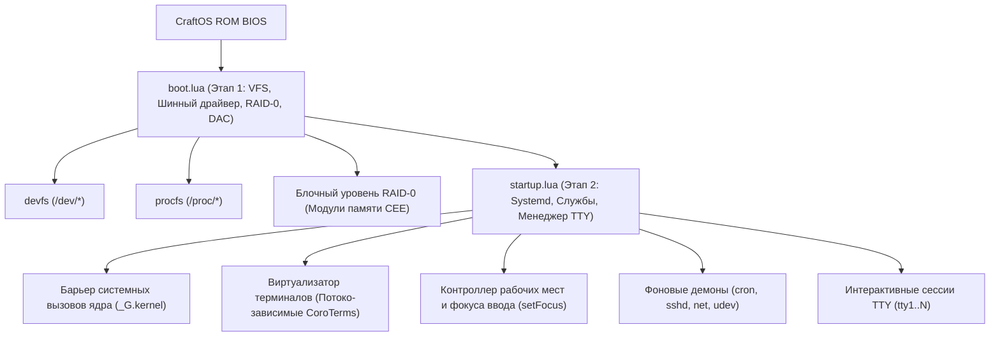
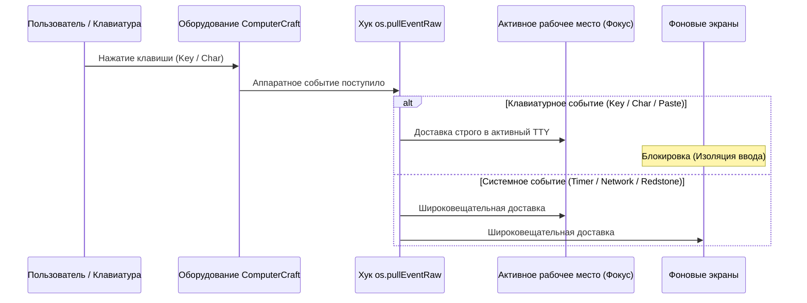

# Luna OS: Справочник API ядра и подсистем для разработчиков

Подробная техническая спецификация всех методов, системных вызовов ядра, виртуальных устройств и механизмов виртуализации, созданных или перехваченных Luna OS в `boot.lua` (Этап 1: Загрузчик и VFS), `startup.lua` (Этап 2: Инициализация, Systemd и TTY) и системных библиотеках.

---

## Содержание

1. [Архитектура и этапы загрузки](#1-архитектура-и-этапы-загрузки)
2. [Перехваты файловой системы и VFS (fs API)](#2-перехваты-файловой-системы-и-vfs-fs-api)
3. [Узлы виртуальных устройств (/dev/*)](#3-узлы-виртуальных-устройств-dev)
4. [Псевдофайловая система процессов (/proc/*)](#4-псевдофайловая-система-процессов-proc)
5. [Виртуализация терминалов и многомониторный движок (term API)](#5-виртуализация-терминалов-и-многомониторный-движок-term-api)
6. [Подсистема событий и фокус рабочих мест (os API)](#6-подсистема-событий-и-фокус-рабочих-мест-os-api)
7. [Диспетчер системных вызовов ядра (_G.kernel и _G.SYS)](#7-диспетчер-системных-вызовов-ядра-_gkernel-и-_gsys)
8. [Подсистема Systemd и безопасность DAC (_G.systemd)](#8-подсистема-systemd-и-безопасность-dac-_gsystemd)
9. [Окружение оболочки и изоляция путей (shell API)](#9-окружение-оболочки-и-изоляция-путей-shell-api)
10. [Библиотека виртуальных терминалов (/usr/lib/tty.lua)](#10-библиотека-виртуальных-терминалов-usrlibttylua)
11. [Сетевой стек и протоколы (_G.LunaNet)](#11-сетевой-стек-и-протоколы-_glunanet)

---

## 1. Архитектура и этапы загрузки

Luna OS построена как модульная, POSIX-совместимая UNIX-подобная операционная система для окружения ComputerCraft / CC: Tweaked и Create: Computer Energetics (CEE).



### Последовательность инициализации:
1. **Обнаружение оборудования (`boot.lua`):** Сканирует подключённые модули памяти CEE и внешние мониторы. Объединяет физические накопители в единый чередующийся дисковый массив RAID-0.
2. **Перехват VFS:** Глобальная таблица `fs` перехватывается для обслуживания виртуальных путей (`/dev`, `/proc`, `/boot`), прозрачно применяя фильтрацию прав доступа Discretionary Access Control (DAC). Исходные функции CraftOS сохраняются в `_G.ORIG_FS`.
3. **Передача управления Этапу 2 (`startup.lua`):** Запускает супервизор `systemd`, конфигурирует маршрутизацию вывода терминала по корутинам, распределяет мониторы по рабочим столам TTY, проверяет учётные записи и запускает фоновые службы.

---

## 2. Перехваты файловой системы и VFS (fs API)

Все операции ввода-вывода файлов проходят через абстракцию VFS первого этапа загрузки. Исходные методы доступны через `_G.ORIG_FS`.

| Метод | Статус | Сигнатура | Описание работы |
| :--- | :--- | :--- | :--- |
| `fs.open` | **Перехвачен** | `fs.open(path, mode)` | Перехватывает обращения к `/dev/*`, виртуальным метрикам `/proc/*` и адресам блоков RAID-0. Выполняет проверку прав доступа DAC (`r`, `w`, `a`) через `systemd.checkAccess`. Возвращает дескриптор файла или виртуальный поток устройства. |
| `fs.exists` | **Перехвачен** | `fs.exists(path)` | Возвращает `true` для зарегистрированных виртуальных устройств, записей procfs и реальных файлов в активном дисковом томе. Разрешает относительные пути с учётом текущей директории. |
| `fs.isDir` | **Перехвачен** | `fs.isDir(path)` | Идентифицирует точки монтирования (`/dev`, `/proc`, `/boot`, `/etc`) как каталоги. Возвращает `false` для файлов символьных и блочных устройств. |
| `fs.list` | **Перехвачен** | `fs.list(path)` | Объединяет список файлов на диске со списком виртуальных устройств (в `/dev`) или идентификаторов активных процессов (в `/proc`). |
| `fs.getSize` | **Перехвачен** | `fs.getSize(path)` | Вычисляет точный размер файла в байтах с учётом фрагментов чередования RAID-0 или рассчитывает длину потока виртуальных файлов. |
| `fs.attributes` | **Перехвачен** | `fs.attributes(path)` | Возвращает расширенные атрибуты в стандарте POSIX: восьмеричную маску доступа (`mode`), владельца, группу, размер и временные метки изменения. |
| `fs.makeDir` | **Перехвачен** | `fs.makeDir(path)` | Проверяет права на запись в родительской директории перед созданием. Рекурсивно создает отсутствующие промежуточные каталоги. |
| `fs.delete` | **Перехвачен** | `fs.delete(path)` | Защищает системные точки монтирования и виртуальные узлы устройств. Требует права на запись в целевом каталоге. |
| `fs.copy` | **Перехвачен** | `fs.copy(src, dst)` | Выполняет потоковое копирование между разделами и томами RAID-0 с валидацией прав на чтение источника и запись в приёмник. |
| `fs.move` | **Перехвачен** | `fs.move(src, dst)` | Выполняет атомарное перемещение внутри раздела или поблочный перенос между разделами с сохранением прав доступа. |
| `fs.isReadOnly` | **Перехвачен** | `fs.isReadOnly(path)` | Возвращает `true` для системных виртуальных файлов (`/proc/*`) и защищённых точек монтирования. |

---

## 3. Узлы виртуальных устройств (/dev/*)

Luna OS представляет периферийные устройства, виртуальные приёмники вывода и диски в виде файлов устройств внутри `/dev/`.

| Узел | Права | Режимы | Назначение |
| :--- | :--- | :--- | :--- |
| `/dev/null` | `0666` | `r`, `w`, `a` | Поглощает любые записанные данные; чтение немедленно возвращает признак конца файла (`nil`). |
| `/dev/zero` | `0444` | `r`, `rb` | Источник непрерывного потока нулевых байтов (`\0`). |
| `/dev/random`, `/dev/urandom` | `0444` | `r`, `rb` | Криптографически инициализированный генератор псевдослучайных байт. |
| `/dev/terminal`, `/dev/console` | `0666` | `w`, `a` | Прямой вывод данных в буфер основного монитора/корпуса компьютера. |
| `/dev/tty` | `0666` | `r`, `w`, `a` | Динамически перенаправляет ввод-вывод на экран TTY, закреплённый за текущей корутиной. |
| `/dev/tty1` .. `/dev/ttyN` | `0660` | `w`, `a` | Прямая запись в буфер указанного TTY независимо от того, какой экран сейчас сфокусирован. |
| `/dev/mon0` .. `/dev/monN` | `0666` | `w`, `a` | Прямой вывод на аппаратный периферийный монитор (по индексу подключения). |
| `/dev/<имя>` (например, `/dev/left`) | `0666` | `w`, `a` | Именованные мониторы, заданные в файле конфигурации `/etc/conf/system.lua`. |
| `/dev/speaker`, `/dev/sound` | `0660` | `w`, `wb` | Прямой аудио-поток для отправки DFPWM / PCM звуковых чанков на подключённые динамики. |
| `/dev/raid0` | `0600` | `r`, `w` | Блочный интерфейс прямого байтового доступа к объединенному массиву памяти RAID-0. |
| `/dev/boot` | `0600` | `r`, `w` | Блочный доступ к разделу постоянной энергонезависимой памяти загрузочного модуля. |

---

## 4. Псевдофайловая система процессов (/proc/*)

Системные метрики ядра и состояние процессов доступны для чтения через файлы в каталоге `/proc/`.

| Путь к файлу | Формат | Описание |
| :--- | :--- | :--- |
| `/proc/version` | Текст | Версия ядра Luna OS, дата сборки и версия компилятора. |
| `/proc/uptime` | Текст | Время работы системы в секундах с момента включения и таймер простоя. |
| `/proc/meminfo` | Ключ-Значение | Общий, свободный и занятый объём памяти по всем обнаруженным модулям. |
| `/proc/cpuinfo` | Ключ-Значение | Архитектура компьютера, ID терминала и тактовая частота. |
| `/proc/partitions` | Таблица | Список смонтированных модулей памяти, размеры чанков и ёмкость. |
| `/proc/mounts` | Таблица | Список точек монтирования, узлов устройств, типов ФС и флагов. |
| `/proc/<PID>/status` | Ключ-Значение | Имя процесса, статус (`running`, `sleeping`, `dead`), UID, GID и родительский PPID. |
| `/proc/<PID>/cmdline` | Текст | Полная строка аргументов, с которыми был запущен процесс. |

---

## 5. Виртуализация терминалов и многомониторный движок (term API)

Глобальный объект `term` заменён на потоко-ориентированный виртуальный диспетчер (`vTerm`). Стандартные вызовы ComputerCraft автоматически исполняются в экранном буфере, привязанном к текущей корутине.

### Алгоритм определения терминала корутины (`getCoroTerm`):
```lua
local function getCoroTerm()
    local co = coroutine.running()
    if not co then return nativeTerm end
    if coroTerms[co] then return coroTerms[co] end
    local myTTY = ttyOwners[co]
    if myTTY and ttyTerms[myTTY] then return ttyTerms[myTTY] end
    return nativeTerm
end
```

### Виртуализированные методы вывода:
* `term.write(text)`: Выводит строку в позиции курсора виртуального терминала текущей задачи.
* `term.clear()`: Очищает только буфер экрана, привязанного к вызывающей задаче.
* `term.setCursorPos(x, y)` / `term.getCursorPos()`: Управляет позицией курсора в окне терминала вызывающего процесса.
* `term.getSize()`: Возвращает размеры (ширину и высоту), рассчитанные индивидуально под разрешение и масштаб текущего монитора.
* `term.setTextColor(color)` / `term.setBackgroundColor(color)`: Устанавливает цвет шрифта и фона буфера.
* `term.blit(text, fg, bg)`: Высокоскоростной посимвольный вывод многоцветного текста напрямую в экранный буфер.
* `term.redirect(target)`: Явно перенаправляет поток вывода текущей корутины на другой экран или объект `window`.
* `term.native()`: Всегда возвращает оригинальный аппаратный терминал компьютера в обход виртуализации.

---

## 6. Подсистема событий и фокус рабочих мест (os API)

Luna OS перехватывает функции `os.pullEvent` и `os.pullEventRaw`, обеспечивая изоляцию ввода: клавиатурные события поступают только на сфокусированный экран.



### Функции управления фокусом:
* **`_G.setFocus(target)`**
  * **Параметры:** `target` (*string|number*) — Путь к устройству (`"/dev/mon1"`), псевдоним (`"left"`) или номер рабочего стола (`1`).
  * **Возвращает:** `boolean, string?` — `true` при успехе или `false, err`, если устройство не найдено.
  * **Действие:** Переключает клавиатурный ввод и обработку нажатий исключительно на указанный монитор.
* **`_G.getFocus()`**
  * **Возвращает:** `string` — Имя устройства текущего активного экрана (например, `"/dev/mon1"`).
* **`_G._DEVICE_MONITORS`**
  * **Тип:** `table<string, table>` — Глобальная таблица соответствия имён и путей устройств объектам периферийных мониторов.

---

## 7. Диспетчер системных вызовов ядра (_G.kernel и _G.SYS)

Функции ядра выполняются за барьером безопасности через системный вызов `_G.kernel.syscall(SYS_ID, ...)`.

| Системный вызов | Код | Аргументы | Возвращаемые значения | Описание |
| :--- | :---: | :--- | :--- | :--- |
| `SYS.EXIT` | 1 | `(code)` | `void` | Завершает вызывающий процесс с кодом возврата. |
| `SYS.SPAWN` | 2 | `(name, cmd, targetUser, ppid)` | `pid` или `nil, err` | Создаёт новый процесс в изолированном потоке. |
| `SYS.READ` | 3 | `(fd, count)` | `data` | Читает до `count` байт из дескриптора. |
| `SYS.WRITE` | 4 | `(fd, data)` | `bytesWritten` | Записывает строку или бинарный буфер в дескриптор. |
| `SYS.OPEN` | 5 | `(path, mode)` | `fd` или `nil, err` | Открывает виртуальный или реальный файл с проверкой DAC. |
| `SYS.CLOSE` | 6 | `(fd)` | `boolean` | Сбрасывает буферы и закрывает файловый дескриптор. |
| `SYS.GETPID` | 7 | `()` | `pid` | Возвращает идентификатор текущего процесса (PID). |
| `SYS.GETPPID` | 8 | `()` | `ppid` | Возвращает PID родительского процесса. |
| `SYS.KILL` | 9 | `(pid, signal)` | `boolean, err?` | Отправляет POSIX-сигнал процессу по его PID. |
| `SYS.SYNC` | 10 | `()` | `boolean` | Сбрасывает дисковые кэши на физические модули памяти. |
| `SYS.REBOOT` | 11 | `()` | `void` | Синхронизирует накопители и перезагружает систему. |
| `SYS.POWEROFF` | 12 | `()` | `void` | Синхронизирует накопители и выключает питание. |
| `SYS.UPTIME` | 13 | `()` | `number` | Возвращает время работы системы в секундах. |
| `SYS.UNAME` | 14 | `()` | `table` | Возвращает `{ sysname, nodename, release, version, machine }`. |
| `SYS.PROCLIST` | 15 | `()` | `table` | Возвращает список дескрипторов всех активных процессов. |
| `SYS.CHECKACCESS`| 16 | `(path, req)` | `boolean` | Проверяет права вызывающего на операции `'r'`, `'w'` или `'x'`. |
| `SYS.GETUSER` | 17 | `()` | `string` | Возвращает имя пользователя текущего потока. |
| `SYS.SETUSER` | 19 | `(newUser)` | `boolean, err?` | Меняет пользователя текущего процесса (только root). |
| `SYS.HOSTNAME` | 21 | `[newHostname]` | `string` | Возвращает или изменяет сетевое имя компьютера. |
| `SYS.USERADD` | 22 | `(username, ...)` | `boolean, err?` | Регистрирует учётную запись и создает домашнюю папку. |
| `SYS.USERDEL` | 23 | `(username, rmHome)`| `boolean, err?` | Удаляет пользователя и (опционально) его директорию. |
| `SYS.DEVLIST` | 24 | `()` | `table` | Возвращает перечень обнаруженных устройств и шин. |
| `SYS.GETHOME` | 25 | `(user)` | `string` | Возвращает канонический путь к домашней папке пользователя. |
| `SYS.GETCONFIG` | 26 | `(app, user)` | `string` | Разрешает путь к каталогам `/etc/conf/` или `~/.config/`. |
| `SYS.GETTTY` | 27 | `()` | `string` | Возвращает имя TTY, закреплённого за текущим процессом. |
| `SYS.SETTTY` | 28 | `(targetTTY)` | `boolean` | Переназначает процесс на другой виртуальный терминал. |

---

## 8. Подсистема Systemd и безопасность DAC (_G.systemd)

`_G.systemd` отвечает за проверку прав доступа Discretionary Access Control (DAC) и супервизию фоновых служб.

### Методы аутентификации и пользователей:
* **`systemd.getUser(username)`**: Возвращает таблицу пользователя `{ uid, gid, home, shell, password }`.
* **`systemd.verifyPassword(username, password)`**: Проверяет пароль против сохранённого соленого хеша.
* **`systemd.setPassword(username, newPass)`**: Обновляет хеш пароля указанной учётной записи.
* **`systemd.userAdd(username, password, uid, gid, gecos, home, shell)`**: Создаёт пользователя и инициализирует `/home/<user>`.
* **`systemd.userDel(username, removeHome)`**: Удаляет пользователя и (опционально) очищает каталог `/home/<user>`.

### Движок безопасности DAC:
* **`systemd.checkAccess(path, user, req)`**:
  * Проверяет запрошенные права `'r'` (чтение), `'w'` (запись) или `'x'` (выполнение).
  * Пользователь `root` автоматически обходит все проверки.
  * Обычные пользователи проверяются последовательно: биты владельца (Owner), биты группы (Group) и биты остальных (Others).
* **`systemd.chmod(path, mode)`**: Устанавливает восьмеричный режим прав доступа (например, `"0755"`, `"0600"`).
* **`systemd.chown(path, owner, group)`**: Назначает нового владельца и группу файла или директории.

### Управление жизненным циклом демонов:
* **`systemd.serviceList()`**: Возвращает таблицу состояния всех сконфигурированных служб.
* **`systemd.serviceStart(name)`**: Запускает фоновую службу в супервизируемой корутине.
* **`systemd.serviceStop(name)`**: Останавливает выполняющуюся службу.
* **`systemd.serviceEnable(name)`**: Включает автозапуск службы при загрузке системы.
* **`systemd.serviceDisable(name)`**: Отключает автозапуск службы при загрузке.

---

## 9. Окружение оболочки и изоляция путей (shell API)

Luna OS изолирует окружение `shell`, предотвращая утечки встроенных утилит CraftOS из директории `/rom/`.

| Метод | Статус | Описание |
| :--- | :--- | :--- |
| `shell.resolveProgram(command)` | **Перехвачен** | Ищет бинарник строго по путям `/usr/bin/core`, `/usr/bin/extra`, `/usr/bin` и `/etc`. Блокирует исполнение из `/rom/`. |
| `shell.programs()` | **Перехвачен** | Возвращает список всех установленных системных утилит без встроенных скриптов CraftOS ROM. |
| `shell.complete(line)` | **Перехвачен** | Контекстное автодополнение команд, ключей и путей файлов текущей директории. |
| `shell.setPath(path)` | **Стандартный** | Задает пути поиска исполняемых файлов (через двоеточие). |
| `shell.setDir(dir)` | **Стандартный** | Устанавливает текущую рабочую директорию. |
| `shell.setAlias(alias, target)` | **Стандартный** | Регистрирует псевдонимы команд (например, `adduser` -> `useradd`). |

---

## 10. Библиотека виртуальных терминалов (/usr/lib/tty.lua)

Библиотека `tty` предоставляет интерфейс для программного управления мониторами и рабочими столами из прикладных программ.

```lua
local tty = require("tty")

-- Получить список всех доступных TTY и подключённых экранов
local workspaces = tty.list()

-- Отправить уведомление на второй монитор без переключения фокуса пользователя
tty.write("tty2", "Фоновая сборка проекта успешно завершена.\n")

-- Переключить интерактивный ввод клавиатуры на монитор 2
tty.switch("tty2")
```

### Сводка методов:
* **`tty.list()`**: Возвращает таблицу всех доступных рабочих столов TTY и сопоставленных с ними периферийных мониторов.
* **`tty.get(name)`**: Возвращает объект виртуального терминала для указанного TTY.
* **`tty.current()`**: Возвращает имя TTY, в котором исполняется вызывающий процесс.
* **`tty.write(name, text)`**: Записывает текст напрямую в файл устройства `/dev/<name>`.
* **`tty.clear(name)`**: Очищает экран и сбрасывает курсор целевого терминала.
* **`tty.switch(name)`**: Переключает фокус клавиатуры на указанный TTY.
* **`tty.run(name, command, ...)`**: Запускает программу с выводом в буфер целевого TTY.

---

## 11. Сетевой стек и протоколы (_G.LunaNet)

`_G.LunaNet` (библиотека `/usr/bin/core/net.lua`) обеспечивает передачу структурированных сетевых пакетов через беспроводные модемы CC и проводные сети CEE.

### Основные сетевые методы:
* **`net.send(targetIp, port, payload, protocol, reqId)`**:
  * Отправляет сетевой пакет `LUNA_NET` (широковещательно или адресно) через все активные сетевые адаптеры.
  * Формирует стандартные заголовки: `{ protocol = "LUNA_NET", type = "DATA", src_ip, dst_ip, src_port, dst_port, payload, req_id }`.
* **`net.listen(port, callback)`**: Регистрирует обработчик входящих пакетов для указанного сетевого порта.
* **`net.loadConfig()`**: Загружает сетевые параметры из `/etc/conf/network.conf` (`ip`, `netmask`, `gateway`, `hostname`).
* **`net.saveConfig(configTable)`**: Сохраняет обновлённые параметры сети в конфигурационный файл.

### Фоновый обработчик ICMP Ping на уровне ядра:
Цикл обработки событий Этапа 2 (`startup.lua`) перехватывает сетевые события `cee_message`, `cee_packet` и `modem_message`:
* При получении пакета с командой `cmd == "PING"`, адресованного локальному IP-адресу машины, ядро автоматически формирует и отправляет ответный пакет `PONG`.
* Ответ на ping происходит прозрачно на уровне ядра и не требует запущенных пользовательских сетевых демонов или SSH-серверов.

