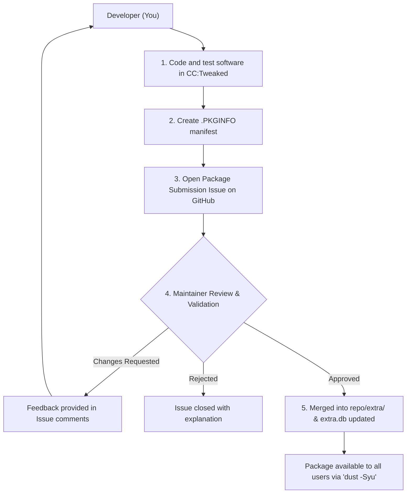

# Luna OS: Package Developer & Contributor Guide

A comprehensive guide for third-party developers creating custom applications, utilities, and games for **Luna OS** and submitting them for official inclusion via GitHub Issues.

---

## Table of Contents

1. [Package Submission Lifecycle](#1-package-submission-lifecycle)
2. [Packaging Standards & Guidelines](#2-packaging-standards--guidelines)
3. [Package Layout & Filesystem Paths](#3-package-layout--filesystem-paths)
4. [Package Metadata Manifest (.PKGINFO)](#4-package-metadata-manifest-pkginfo)
5. [Overrides Mechanism (Patching Existing Packages)](#5-overrides-mechanism-patching-existing-packages)
6. [Pre-Submission Verification](#6-pre-submission-verification)
7. [GitHub Issue Submission Template](#7-github-issue-submission-template)
8. [Review Criteria: Approval & Rejection](#8-review-criteria-approval--rejection)
9. [Updating Existing Packages](#9-updating-existing-packages)

---

## 1. Package Submission Lifecycle

Luna OS maintains a curated repository of packages distributed through the `dust` package manager and managed by the repository maintainer (@TheEartHTM). The contribution process follows a clear review lifecycle:



You **do not need** to directly edit repository database files (`extra.db`) or push branches: submit your source repository and metadata, and the maintainer will review, approve, and register your package.

---

## 2. Packaging Standards & Guidelines

To ensure system stability, multi-monitor safety, and compatibility with ComputerCraft: Tweaked (CC:T) and Create: Computer Energetics (CEE), all packages must adhere to the following standards:

### 2.1. Strict ASCII English Encoding
* All code, filenames, terminal output, error logs, and comments must strictly use 7-bit ASCII English. Non-ASCII or Unicode characters can corrupt standard ComputerCraft screen buffers or crash rendering pipelines.

### 2.2. Cooperative Multitasking & Safety
* **No Unyielding Loops:** Never use infinite loops (`while true do end`) without yielding control via `sleep()`, `os.pullEvent()`, or `coroutine.yield()`. Unyielding loops crash the CC:Tweaked Lua VM with `Too long without yielding`.
* **Graceful Termination:** Programs must respond cleanly to `Ctrl+T` termination events unless explicitly configured as a background daemon managed by `systemd`.

### 2.3. Filesystem Sandboxing
* Community packages belong in the `extra` tier. Packages must **never overwrite core system files** (`/usr/bin/core/`, `/boot.lua`, `/startup.lua`, `/etc/systemd/`).
* Dynamic user configuration files must reside in `/etc/conf/<pkgname>.conf` and be declared in the `.PKGINFO` `backup` field to avoid overwriting during upgrades.

---

## 3. Package Layout & Filesystem Paths

Luna OS standardizes installation paths into two common application tiers:

### Option A: Standalone Console Utility
For single-file CLI tools (e.g., `timer`):
```
repo/extra/timer/
├── .PKGINFO
└── timer.lua
```
* **Target Installation Path (`path`):** `/usr/bin/extra`
* Executable directly from terminal via `timer`.

### Option B: Complex Multi-File Application (TUI / GUI / Daemon)
For applications with internal libraries, themes, or assets (e.g., `luaamp`):
```
repo/extra/myapp/
├── .PKGINFO
├── myapp.lua              # Main executable entry point
├── myapp.conf             # Default configuration template
└── lib/                   # Internal modules
    ├── ui.lua
    └── audio.lua
```
* **Target Installation Path (`path`):** `/opt/myapp`
* **CLI Wrapper / Launcher:** `/usr/bin/extra/myapp` (delegates execution to `/opt/myapp/myapp.lua`).
* **Configuration:** `/etc/conf/myapp.conf`.

---

## 4. Package Metadata Manifest (.PKGINFO)

Every package must contain a `.PKGINFO` file in its root directory:

```ini
# Generated for Luna OS
pkgname = myapp
pkgver = 1.0.0-1
pkgdesc = Fast and lightweight telemetry viewer for CEE
repo = extra
path = /opt/myapp
group = monitoring
license = MIT
packager = YourNickname <developer@example.com>
url = https://github.com/YourNickname/myapp
builddate = Mon Nov 23 12:00:00 2026
backup = /etc/conf/myapp.conf
deps = coreutils, curl
```

### Manifest Field Reference:
| Field | Required | Description |
| :--- | :---: | :--- |
| `pkgname` | Yes | Unique package identifier (lowercase alphanumeric and hyphens only, e.g. `moon-edit`). |
| `pkgver` | Yes | Semantic version and release tag: `<version>-<release>` (e.g. `1.0.0-1`). |
| `pkgdesc` | Yes | Concise English summary of the package (single line). |
| `repo` | Yes | Always `extra` for community submissions. |
| `path` | Yes | System target folder: `/usr/bin/extra` or `/opt/<pkgname>`. |
| `group` | No | Category: `utils`, `games`, `monitoring`, `multimedia`, `development`. |
| `license` | Yes | Open-source license identifier (e.g. `MIT`, `GPL-3.0`, `Unlicense`). |
| `packager` | Yes | Developer handle and email/contact. |
| `url` | Yes | Link to your GitHub repository or project homepage. |
| `builddate` | Yes | Build timestamp string. |
| `backup` | No | Configuration file paths preserved across updates. |
| `deps` | No | Comma-separated list of required packages (e.g. `coreutils`). |

---

## 5. Overrides Mechanism (Patching Existing Packages)

If you are **not creating a new package from scratch**, but need to customize an existing upstream tool or library for Luna OS, use the **Overrides** mechanism.

### What is an Override?
An override allows replacing specific files of an existing package without maintaining an entire fork of upstream code. Common use-cases:
* Adjusting file paths to comply with Luna OS conventions.
* Patching graphics/TUI pipelines for CEE multi-monitor compatibility (`/dev/monN`).
* Adapting default keybindings or configs.

### How to Propose an Override:
1. Identify the target package (e.g. `luaamp`).
2. Provide the patched file (e.g. `overrides/luaamp/config.lua`).
3. Explain why the override is necessary in the GitHub Issue.

The maintainer will place the file in `repo/overrides/<pkgname>/<file>` and register it under the `["overrides"]` list in the repository database.

---

## 6. Pre-Submission Verification

Before opening an issue, verify your application:

1. **Lua Syntax Validation:**
   ```bash
   luac -p myapp.lua lib/*.lua
   ```

2. **In-Game Testing:**
   * Run the application in a ComputerCraft: Tweaked terminal.
   * Verify command-line arguments work as expected.
   * If your app supports monitors, test standard redirection: `myapp > /dev/mon1`.
   * Test clean exit on `Ctrl+T` (`terminate`).

---

## 7. GitHub Issue Submission Template

To submit your package, open a [New GitHub Issue](https://github.com/TheEartHTM/luna/issues/new) titled:
`[Package Request] <pkgname> <version>` or `[Override Request] <pkgname>`

Copy and fill out the template below:

```markdown
### Package Information
- **Package Name:** myapp
- **Version:** 1.0.0-1
- **Category:** utils
- **License:** MIT
- **Source Repository:** https://github.com/YourName/myapp

### Description
A concise description of the application and its features.

### Installation Details
- **Target Path:** /opt/myapp (or /usr/bin/extra)
- **Dependencies:** coreutils
- **Config / Backup Files:** /etc/conf/myapp.conf

### File Structure & Components
- `myapp.lua` -> executable launcher
- `lib/ui.lua` -> user interface module
- `myapp.conf` -> default configuration template
- `.PKGINFO` -> package manifest

### Testing Checklist
- [x] Tested in CC:Tweaked / CEE environment.
- [x] Strictly ASCII English strings, output, and comments.
- [x] Does not overwrite /usr/bin/core/ or kernel files.
- [x] Exits cleanly without hanging the Lua VM.
```

---

## 8. Review Criteria: Approval & Rejection

The maintainer reviews each submission according to standard criteria:

### ✅ Approval Criteria:
* Source code is readable, safe, and solves a real problem or adds entertainment value.
* Manifest fields (`.PKGINFO`) and destination paths conform to specifications.
* No name collisions with existing packages.
* Compatible open-source license provided.
* Pure ASCII English strings and documentation.

### ❌ Reasons for Rejection or Rework:
* Malicious behavior (destructive file deletion, unprovoked system crashes).
* Infinite unyielding loops that trigger CC:Tweaked coroutine timeouts.
* Attempts to overwrite core operating system files without an approved `override` justification.
* Missing manifest, broken syntax, or unreachable source repository.

---

## 9. Updating Existing Packages

When releasing a new version:
1. Bump `pkgver` in `.PKGINFO` (e.g. `1.0.0-1` $\to$ `1.1.0-1`).
2. Open a GitHub Issue titled:
   `[Package Update] myapp: 1.0.0-1 -> 1.1.0-1`
3. Include the link to the commit/release and a brief changelog.
4. Once reviewed, the maintainer updates the package in the repository.
5. All Luna OS computers receive the update automatically via `dust -Syu`.
