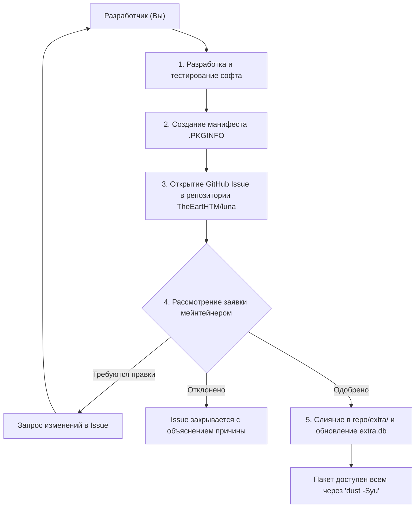

# Luna OS: Руководство для разработчиков пакетов

Руководство для разработчиков сторонних программ, утилит и игр, желающих опубликовать свои пакеты в официальном репозитории **Luna OS** (`dust`) через GitHub Issues.

---

## Содержание

1. [Как устроен процесс публикации](#1-как-устроен-процесс-публикации)
2. [Стандарты и требования к пакетам](#2-стандарты-и-требования-к-пакетам)
3. [Структура пакета и пути установки](#3-структура-пакета-и-пути-установки)
4. [Манифест пакета (.PKGINFO)](#4-манифест-пакета-pkginfo)
5. [Использование механизма Overrides (патчи поверх существующих пакетов)](#5-использование-механизма-overrides-патчи-поверх-существующих-пакетов)
6. [Локальное тестирование перед отправкой](#6-локальное-тестирование-перед-отправкой)
7. [Шаблон заявки на публикацию (GitHub Issue)](#7-шаблон-заявки-на-публикацию-github-issue)
8. [Критерии модерации (Одобрение и Отклонение)](#8-критерии-модерации-одобрение-и-отклонение)
9. [Обновление уже опубликованного пакета](#9-обновление-уже-опубликованного-пакета)

---

## 1. Как устроен процесс публикации

Luna OS использует централизованный репозиторий пакетов, управляемый мейнтейнером (@TheEartHTM). Публикация нового софта или обновлений строится по прозрачной схеме:



Вам **не требуется** вручную коммитить в базу данных (`extra.db`) или форкать репозиторий: достаточно подготовить исходный код, манифест `.PKGINFO` и оформить заявку в Issue.

---

## 2. Стандарты и требования к пакетам

Для обеспечения стабильности системы и совместимости с ComputerCraft: Tweaked (CC:T) и Create: Computer Energetics (CEE) все пакеты должны соответствовать правилам:

### 2.1. Кодировка и язык
* **Только ASCII English:** Все исходные файлы, переменные, комментарии, логи и текстовые выводы в терминал должны быть строго в ASCII (латиница). Кириллица и специальные символы могут ломать рендеринг стандартного терминала ComputerCraft.

### 2.2. Архитектура и неблокирующий код
* Запрещены бесконечные циклы `while true do end` без вызова `sleep()`, `os.pullEvent()` или `coroutine.yield()`. Программа не должна намертво вешать планировщик Lua.
* Программа должна корректно завершаться при нажатии `Ctrl+T` (`terminate`), если только это не фоновый демон, зарегистрированный в systemd.

### 2.3. Изоляция файлов
* Пакеты из репозитория `extra` **никогда не должны перезаписывать системные файлы** ядра (`/usr/bin/core/`, `/boot.lua`, `/startup.lua`, `/etc/systemd/`).
* Все изменяемые конфигурации пользователя должны храниться в `/etc/conf/<имя_пакета>.conf` и быть помечены в поле `backup`.

---

## 3. Структура пакета и пути установки

В Luna OS приняты две стандартные схемы компоновки приложений:

### Вариант А: Однофайловая консольная утилита
Если ваша программа — это один Lua-скрипт (например, утилита `timer`):
```
repo/extra/timer/
├── .PKGINFO
└── timer.lua
```
* **Путь установки (`path`):** `/usr/bin/extra`
* В системе утилита будет доступна напрямую по команде `timer`.

### Вариант Б: Комплексное многофайловое приложение (TUI / GUI / Библиотека)
Если ваше приложение содержит модули, стили, ассеты или конфигурацию (например, плеер `luaamp`):
```
repo/extra/myapp/
├── .PKGINFO
├── myapp.lua              # Точка входа / лаунчер
├── myapp.conf             # Дефолтный конфиг
└── lib/                   # Внутренние модули
    ├── ui.lua
    └── core.lua
```
* **Путь установки (`path`):** `/opt/myapp`
* **Симлинк или лаунчер:** `/usr/bin/extra/myapp` (скрипт-обёртка для удобного вызова из терминала).
* **Конфигурация:** `/etc/conf/myapp.conf`.

---

## 4. Манифест пакета (.PKGINFO)

Файл `.PKGINFO` помещается в корень каталога пакета и описывает его свойства:

```ini
# Generated for Luna OS
pkgname = myapp
pkgver = 1.0.0-1
pkgdesc = Fast and lightweight telemetry viewer for CEE
repo = extra
path = /opt/myapp
group = monitoring
license = MIT
packager = YourNickname <developer@example.com>
url = https://github.com/YourNickname/myapp
builddate = Mon Nov 23 12:00:00 2026
backup = /etc/conf/myapp.conf
deps = coreutils, curl
```

### Значение полей:
| Поле | Обязательно | Описание |
| :--- | :---: | :--- |
| `pkgname` | Да | Имя пакета: только строчные латинские буквы, цифры и дефис (например: `moon-edit`). |
| `pkgver` | Да | Версия и релиз: `<версия>-<релиз>` (например: `1.0.0-1`). |
| `pkgdesc` | Да | Краткое описание на английском языке (1 предложение). |
| `repo` | Да | Для сторонних пакетов всегда `extra`. |
| `path` | Да | Куда распаковывать: `/usr/bin/extra` или `/opt/<pkgname>`. |
| `group` | Нет | Категория: `utils`, `games`, `monitoring`, `multimedia`, `development`. |
| `license` | Да | Идентификатор лицензии (например, `MIT`, `GPL-3.0`, `Unlicense`). |
| `packager` | Да | Ваше имя/никнейм и контакт для связи. |
| `url` | Да | Ссылка на ваш репозиторий с исходным кодом. |
| `builddate` | Да | Дата сборки. |
| `backup` | Нет | Файлы конфигурации, которые `dust` не перезаписывает при апдейте. |
| `deps` | Нет | Зависимости из `core` или `extra` через запятую (например: `coreutils`). |

---

## 5. Использование механизма Overrides (патчи поверх существующих пакетов)

Если вы **не создаёте новый пакет с нуля**, а хотите адаптировать существующую программу (например, популярную библиотеку из CC:Tweaked или оригинальное приложение), вы можете предложить **Override**.

### Что такое Override?
Это точечная замена конкретного файла без форка всего оригинального пакета. Например:
* Адаптация путей к файлам под файловую систему Luna OS.
* Патч для вывода графики на мониторы CEE.
* Изменение стандартных горячих клавиш или цветовой палитры.

### Как оформить заявку на Override:
1. Укажите целевой пакет (например, `luaamp`).
2. Предоставьте заменяемый файл (например, `overrides/luaamp/config.lua`).
3. Объясните причину: почему это должно быть заменено в Luna OS.

Мейнтейнер зарегистрирует переопределение в `overrides/<pkgname>/<file>` и укажет его в поле `["overrides"]` базы данных репозитория.

---

## 6. Локальное тестирование перед отправкой

Перед оформлением заявки протестируйте ваше приложение в среде ComputerCraft:

1. **Проверка синтаксиса:**
   В Linux выполните проверку синтаксиса Lua:
   ```bash
   luac -p myapp.lua lib/*.lua
   ```

2. **Запуск в среде ComputerCraft:**
   * Скопируйте файлы на компьютер в CC:Tweaked.
   * Запустите программу в обычном терминале.
   * Проверьте работу аргументов командной строки (`args`).
   * Если приложение использует мониторы — проверьте поведение при перенаправлении (`myapp > /dev/mon1`).
   * Проверьте поведение при завершении (`Ctrl+T` или команда выхода).

---

## 7. Шаблон заявки на публикацию (GitHub Issue)

Чтобы отправить пакет на рассмотрение, создайте [Новый Issue в репозитории TheEartHTM/luna](https://github.com/TheEartHTM/luna/issues/new) с темой:
`[Package Request] <имя_пакета> <версия>` или `[Override Request] <имя_пакета>`

Используйте следующий шаблон:

```markdown
### Package Information
- **Package Name:** myapp
- **Version:** 1.0.0-1
- **Category:** utils
- **License:** MIT
- **Source Repository:** https://github.com/YourName/myapp

### Description
A brief 1-2 sentence description of what the application does.

### Installation Details
- **Target Path:** /opt/myapp (or /usr/bin/extra)
- **Dependencies:** coreutils
- **Config / Backup Files:** /etc/conf/myapp.conf

### File Structure & Contents
List of all files to be packaged or a link to a branch/gist:
- `myapp.lua` -> executable launcher
- `lib/ui.lua` -> user interface module
- `myapp.conf` -> default configuration
- `.PKGINFO` -> metadata manifest

### Testing Evidence
- [x] Verified in CC:Tweaked / CEE.
- [x] Strictly ASCII English strings & comments.
- [x] Does not overwrite /usr/bin/core/ or kernel files.
- [x] Clean exit without hanging.
(Attach a screenshot or terminal output log if possible)
```

---

## 8. Критерии модерации (Одобрение и Отклонение)

Мейнтейнер рассматривает каждую заявку в комментариях к Issue.

### ✅ Пакет будет одобрен, если:
* Код безопасен, понятен и решает реальную задачу.
* Соблюдены правила оформления `.PKGINFO` и путей установки.
* Нет конфликтов имён с уже существующими пакетами.
* Присутствует лицензия с открытым исходным кодом.
* Текст и комментарии соответствуют стандарту ASCII English.

### ❌ Заявка может быть отклонена или отправлена на доработку, если:
* Код содержит вредоносные действия (удаление чужих файлов, бесконечный спам, краш системы).
* Программа зависает при запуске из-за неблокирующих бесконечных циклов.
* Пакет пытается перезаписать системные бинарники ядра без согласованного `override`.
* Отсутствует манифест `.PKGINFO` или репозиторий с исходным кодом недоступен.

---

## 9. Обновление уже опубликованного пакета

Когда вы выпускаете новую версию вашей программы:
1. Увеличьте `pkgver` в `.PKGINFO` (например: `1.0.0-1` $\to$ `1.1.0-1`).
2. Создайте GitHub Issue с заголовком:
   `[Package Update] myapp: 1.0.0-1 -> 1.1.0-1`
3. Укажите ссылку на релизный коммит и список изменений (Changelog).
4. Мейнтейнер обновит файлы в `repo/extra/myapp/` и пересчитает размер в `extra.db`.
5. Все пользователи Luna OS получат обновление при выполнении `dust -Syu`.
